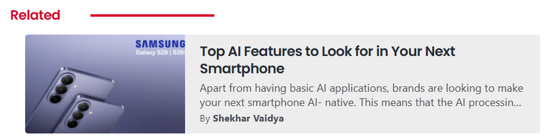
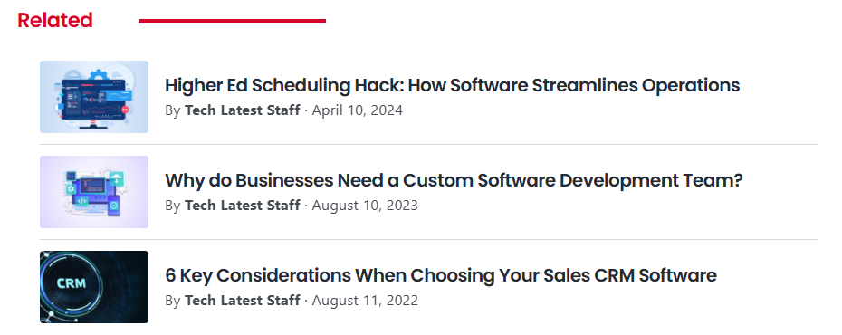
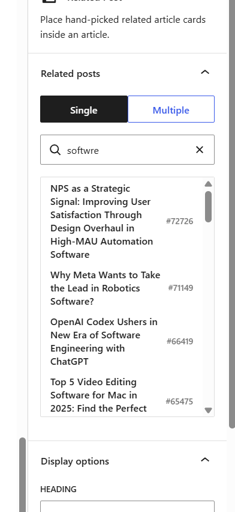

# Inline Related Post

A WordPress block for placing hand-picked related article cards inside an article. You choose the posts yourself, and the search finds them even when you misspell a word.



It was built for [TechLatest](https://tech-latest.com), so a new install starts with its red `#d90429` accent. You can change that and everything else under **Settings → Related Post**, then adjust any single block from its sidebar.

## Features

- **Single or multiple posts:** show one card, or several in a stacked, two-column grid or compact list layout.
- **Search that tolerates typos:** find posts by keyword, post ID or URL. `sansung` finds Samsung and `softwre` finds Software.
- **Site-wide settings with a live preview:** set the defaults once for the whole site. They include colours, a font picker that finds the fonts your site loads, the heading and the card indent.
- **Per-block control:** change the excerpt, author, date, image, heading or colours on a single block, and reset them to the site default whenever you like.
- **Always up to date:** cards read the post when the page loads, so a changed title or image updates everywhere it's linked.
- **Safe with unpublished posts:** if a linked post is deleted or unpublished, readers don't see its card and you get a warning in the editor.
- **Responsive:** cards tighten up in narrow columns, and the excerpt is hidden on phones.
- **No dependencies:** no other plugins, no build step, and no extra fonts or scripts for readers to download.

| Compact list | Search with a typo |
|---|---|
|  |  |

## Requirements

- WordPress 6.3 or newer, using the block editor
- PHP 7.4 or newer

These are the minimums the plugin declares. See [Testing so far](#testing-so-far) for what has actually been run.

## Installation

1. Download `inline-related-post.zip` from the [latest release](https://github.com/starkSV/inline-related-post/releases/latest). Don't use GitHub's green "Download ZIP" button, because its folder name stops WordPress from recognising updates.
2. In WordPress, go to **Plugins → Add New → Upload Plugin** and upload the zip.
3. Activate the plugin.

**To update**, upload the newer zip the same way and choose **Replace current with uploaded**. Then clear any page cache or CDN. Installs don't update themselves from GitHub.

## Usage

1. In the block editor, click the **+** button and add **Related Post**. The settings open in the right sidebar.
2. Choose **Single** or **Multiple**. In Multiple mode, also pick a layout.
3. Pick posts from the list, or search for them. In Multiple mode you can reorder and remove the ones you've selected.
4. Change any display options or colours you want to be different on this block.

The Compact layout never shows the excerpt, so that option is greyed out there.

## Settings

Go to **Settings → Related Post**. The preview uses your theme and latest posts, and nothing goes live until you save.

| Setting | Applies to | Can a block override it? |
|---|---|---|
| Excerpt, author, date, image | All blocks | Yes |
| Heading text | All blocks | Yes |
| Accent, heading, card background and card text colours | All blocks | Yes |
| Mode and multiple layout | New blocks only | Yes, each block keeps its own |
| Font | All blocks | No |
| Card indent | All blocks, except in narrow columns like phones | No |
| Custom CSS | All blocks | No |

A block follows the site settings until you change something on it. Only that one setting then stays fixed, and **Reset to site default** undoes it. Mode and layout work differently, so that changing them can't rearrange cards already in your articles.

**Font:** *System* uses your theme's font for that text. *Custom* lists the fonts found on your homepage and latest post, so you don't need to know the exact name. If yours isn't listed, choose *Other* and type it. The plugin only uses fonts your site already loads and never downloads any.

To find fonts, the settings page briefly loads those two pages in a hidden frame in your browser when Custom is selected, so any analytics on them may record a visit from you. If a security setting blocks this, the list says so and you can type the name.

**Custom CSS:** this is added after the plugin's own styles and shows in the preview as you type. Only users allowed to post unfiltered HTML can change it. Cards use classes like `.irp`, `.irp__heading`, `.irp-card` and `.irp-card__title`.

**Upgrading from a version before 0.4.0:** if your articles already use the block, the font is set to Custom with Poppins so your cards keep their look.

## How search works

Before you type, the list shows the 5 most recent published posts. A search returns up to 50, best match first, in a scrolling list. Equally good matches are listed newest first.

| You type | What happens |
|---|---|
| A post ID | That post comes first, followed by any titles containing the number |
| A post URL | Only that post |
| Words | Titles are ranked in this order: exact word, start of a word, one typo, inside a word, two typos |

- **Whole words count most:** `AI` finds titles with the word "AI", and doesn't match "Chair" or "Training".
- **Typos:** words of 4 or 5 letters can have one mistake, and longer words can have two. Shorter words and anything containing a number must match exactly, so `s24` won't bring up S25.
- **Longer searches:** common words like "the" and "for" are ignored, and about 60% of the remaining words must match.
- **Article text:** if titles give fewer than 50 results, search also checks excerpts and article text for the exact words. Typo tolerance only applies to titles.

**On large sites:** each search reads the ID and title of every published post into memory, and only runs for logged-in editors while searching, so readers aren't affected. On generated test data in a slow test environment, ranking took about 40–80 ms for 5,000 titles, 150–230 ms for 20,000 and 550–860 ms for 75,000. That excludes the database query, and it hasn't been tried on a real site that large.

## For developers

By default only standard posts can be linked. To allow other post types, use the `irp_post_types` filter:

```php
add_filter( 'irp_post_types', function ( $types ) {
	$types[] = 'page';
	return $types;
} );
```

The block is rendered on the server (`block/render.php`), so articles only store the post IDs and the settings you changed on that block. The site settings are in `includes/settings.php`, stored in the `irp_settings` option, and can be changed in code with the `irp_settings` filter. The editor script (`block/editor.js`) uses WordPress's global `wp.*` packages directly, so you can edit it with no build step. The search limits are the `IRP_RECENT_LIMIT` and `IRP_SEARCH_LIMIT` constants in `inline-related-post.php`.

If you remove the plugin, cards stop appearing on your site. The block markup stays in your articles, and the editor will show it as an unsupported block.

## Testing so far

The plugin has been used on one live site (TechLatest) and tested on a local WordPress Playground site running the latest WordPress with PHP 8.3. The settings page has so far only been tested on that local site. The plugin has no automated tests, and it hasn't been tried with older WordPress or PHP versions, with other themes beyond those two sites, or in the site editor. Please open an issue if you find a problem.

## Author

Made by [Shekhar Vaidya](https://github.com/starkSV).

## Licence

[GPL-2.0-or-later](LICENSE)
